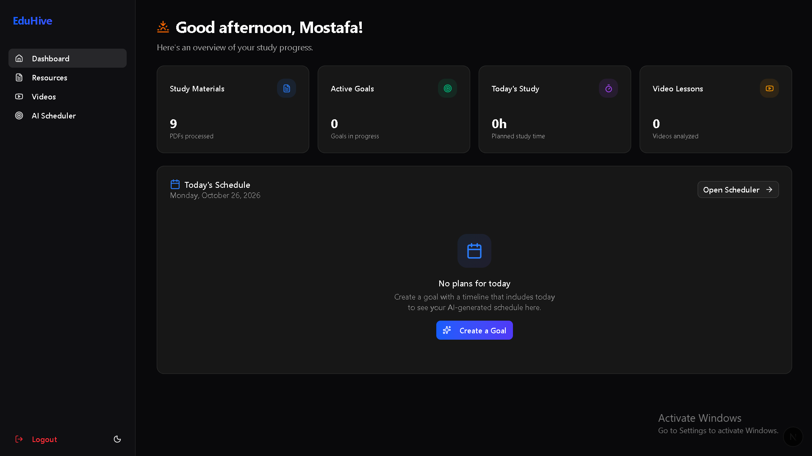
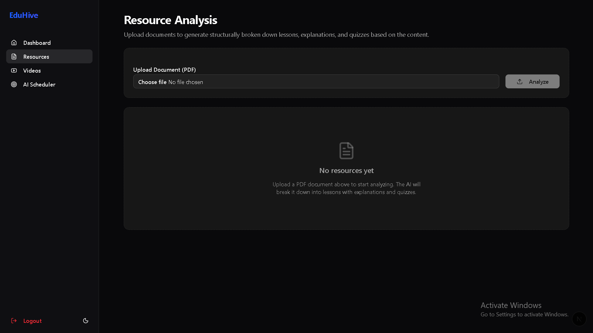
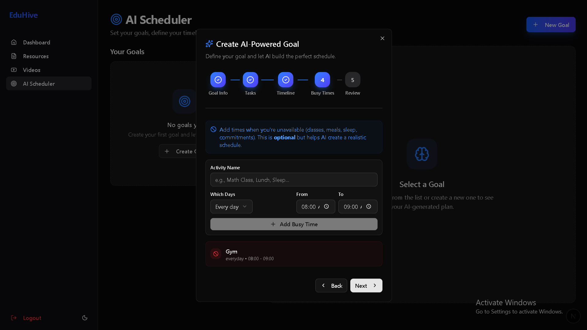
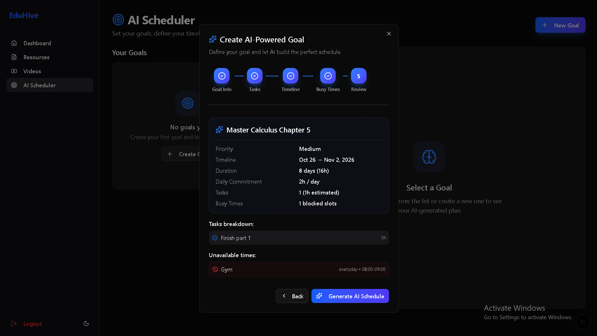
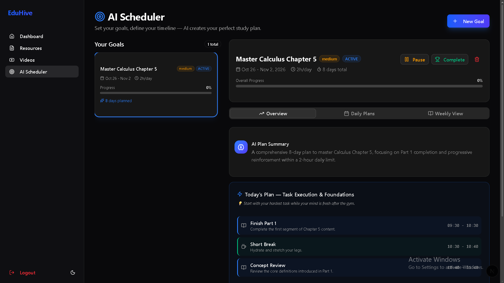
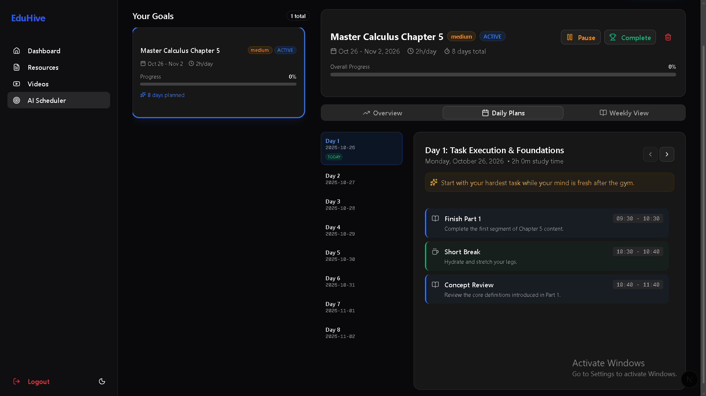
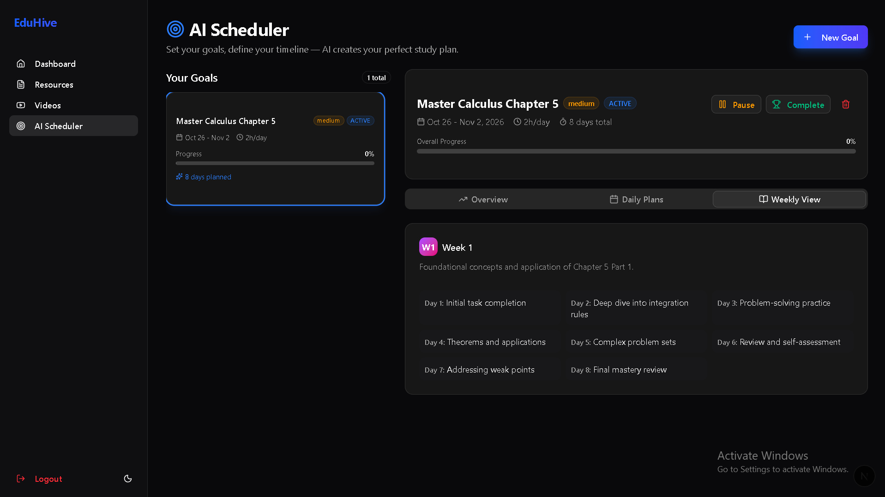

# EduHive Frontend

EduHive is a study assistant for students. You upload a PDF or paste a YouTube link, and it turns the material into short lessons with explanations and quizzes. You can also give it a goal and a deadline, and it builds a day-by-day study schedule around the hours you are free.

This repository is the web app. It talks to the API in [EduHive_Backend](https://github.com/Mostafa-3bmen3m/EduHive_Backend).



## What you can do

- **Create an account and log in.** Pages for the dashboard, resources, videos and scheduler are only open to logged-in users.
- **Dashboard.** See how many documents you have processed and what is planned for today.
- **Analyze a PDF.** Upload a document and get it back split into lessons, each with an explanation and multiple-choice questions, plus a summary. Answers are marked correct or incorrect as you pick them.
- **Analyze a YouTube video.** Paste a link and get a timeline of the video's sections with explanations and quizzes. The video needs captions.
- **Plan your study with the AI Scheduler.** Create a goal in five steps, then read the plan as an overview, day by day, or week by week. You can pause, complete or delete a goal.
- **Light and dark mode.** The toggle is at the bottom of the sidebar.

## Screenshots

### Resources

Upload a PDF and the app breaks it down into lessons and quizzes.



### AI Scheduler

Creating a goal takes five steps: goal info, tasks, timeline, busy times and a final review. The busy times step lets you block out things like classes, meals or the gym so no study sessions are placed on top of them.





Once the schedule is generated, the overview shows a summary and today's plan.



The daily plans tab lists every day of the goal with timed study sessions, breaks and a short tip.



The weekly view shows what each week is focused on.



## Built with

- Next.js 16 (App Router), React 19 and TypeScript
- Tailwind CSS 4 and shadcn/ui components (built on Radix UI)
- Zustand for login state, and a cookie that keeps the login token for 7 days
- React Hook Form and Zod for the login and register forms
- Axios for talking to the backend
- Sonner for notifications, Lucide for icons, `next-themes` for light and dark mode

## Project structure

```
src/
  app/
    login/ register/    account pages
    dashboard/          overview and today's schedule
    resources/          PDF upload, lessons and quizzes
    videos/             YouTube analysis, timelines and quizzes
    schedule/           AI Scheduler (goals and study plans)
  components/
    layout/             sidebar and page layout
    ui/                 shared buttons, cards, dialogs, tabs and so on
  lib/api.ts            Axios setup that adds the login token to requests
  store/authStore.ts    login state
  middleware.ts         sends logged-out users to the login page
```

## Running it locally

You need Node.js 20 or newer and the [backend](https://github.com/Mostafa-3bmen3m/EduHive_Backend) running on port 8080.

```bash
git clone https://github.com/Mostafa-3bmen3m/EduHive_Frontend.git
cd EduHive_Frontend
npm install
npm run dev
```

Open [http://localhost:3000](http://localhost:3000), create an account and log in.

The backend address is set in `src/lib/api.ts` (`http://localhost:8080/api`). Change it there if your backend runs somewhere else.

## Notes

I built EduHive on my own as a high school project. It was chosen as one of the best projects at my school that year.
